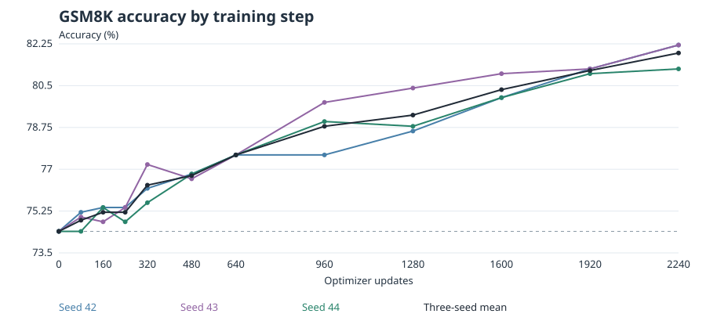
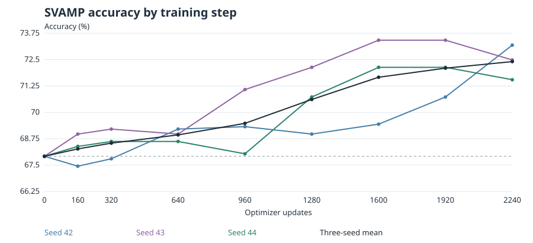

# Qwen2.5-1.5B 数学推理后训练

在 Qwen2.5-1.5B 上进行 LoRA SFT 和 GRPO，研究奖励设计、采样和训练步数对数学准确率的影响。仓库包含训练与评估代码、实验协议、结果统计和训练曲线。

| 对比 | 评估集 | 准确率变化 |
|---|---|---:|
| Base → LoRA SFT | GSM8K 官方测试集（1,319 题） | 22.21% → 61.11% |
| 冻结 SFT → 标准 GRPO 2,240 步 | GSM8K 验证集（500 题，三种子平均） | 74.40% → 81.87%（+7.47 个百分点） |
| 冻结 SFT → 标准 GRPO 2,240 步 | SVAMP 固定评估集（854 题，三种子平均） | 67.92% → 72.40%（+4.49 个百分点） |

实验一至三的 GRPO 每组跑了 160–200 步，主要对比的增益不到 1 个百分点。实验四把标准 GRPO 延长到 640 步，并与动态 GRPO、DPO 和 PPO 做单种子初筛。实验五用三个种子从同一个冻结 SFT 检查点出发，追踪至每个种子 2,240 步。最后两个 320 步区间的平均增益均小于 1 个百分点，置信区间仍不足以确认平台期。实验五使用了此前已评估的两套题。 [实验一至五阶段报告](reports/实验一至五阶段汇总.md)





## 本地检查

在仓库根目录使用 Python 3.11 创建环境。以下测试使用合成数据和小型模型，可以在 CPU 上运行。

```bash
python3.11 -m venv .venv
source .venv/bin/activate
python -m pip install -r requirements-bootstrap.txt
python -m pip install -e .
python -m math_posttrain.cli --help
python -m pytest -q tests
```

初始数据准备可从 `python -m math_posttrain.cli prepare-data --help` 查看。完整训练需要固定版本的底座模型、经审计的数据、冻结 SFT 检查点及相应的 GPU 环境。第五轮入口会校验历史输入哈希，原实验数据与检查点需另行准备。 [第五轮实验协议](grpo-study-v5/README.md) · [机器可读协议](grpo-study-v5/reports/protocol.json) · [2,240 步结果数据](grpo-study-v5/results/phase-2240/results.json)

| 目录 | 内容 |
|---|---|
| `src/math_posttrain/` | 数据审计、训练、检查点、奖励和评估实现 |
| `configs/`、`prompts/`、`tests/` | 实验配置、提示词和测试 |
| `grpo-study-v2/`、`grpo-study-v3/` | 继续 SFT、奖励和难度采样的脚本与报告 |
| `grpo-study-v4/` | 标准与动态 GRPO、DPO、PPO 对照 |
| `grpo-study-v5/` | 三种子训练步数实验、图表及结构化结果 |
